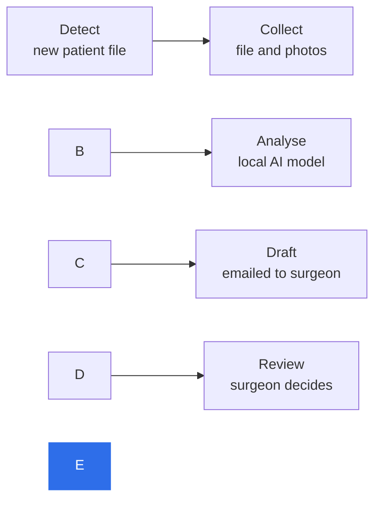

# AestheticDiagnose

**A local, privacy-first AI assistant that drafts aesthetic pre-consultation letters from patient photos and medical files, for the surgeon to review.**

Final project, built with the AI-THINK methodology (Tune, Hypothesis, Implement, Network, Knowledge).

📄 [Project report (PDF)](docs/AestheticDiagnose-report.pdf) · 🖥️ [Slides (PDF)](docs/AestheticDiagnose-slides.pdf) · ▶️ \[3-minute demo video](\[VIDEO LINK])

\---

## The problem

In a private aesthetic clinic, every online patient request needs a long, personalised first opinion from the surgeon. That letter must refer to what the surgeon sees in the photos, judge the feasibility of each requested procedure, and take the medical history into account.

* **It takes time.** Four to five careful paragraphs per patient, competing with consultations and surgery.
* **Patients wait.** Slow answers lose patients to other clinics.
* **The data is sensitive.** Face and body photos with health information cannot be sent to a public AI service.

## The solution

AestheticDiagnose automates the drafting, not the decision.



1. When a patient file is assigned to a surgeon, the workflow picks it up automatically.
2. It gathers the medical context and the photos.
3. A vision-language model, **running entirely on the clinic's own machine**, analyses them.
4. The surgeon receives a draft letter, written in their voice, by email.
5. **Only the surgeon** can correct, approve and send it. The AI never contacts a patient.

## Technology

|Layer|Choice|Why|
|-|-|-|
|AI model|Gemma 4 12B (QAT, 4-bit)|Reads images natively; fits in about 6.3 GB of video memory|
|Model server|Ollama|Simple local inference API|
|Orchestration|n8n|Visual workflow automation, self-hosted|
|Data|MySQL|Read-only access to patient files; separate local tracking database|
|Infrastructure|Docker, WSL2|Reproducible local deployment|
|Hardware|One consumer GPU, 8 GB VRAM|Proves the approach is affordable|

No cloud AI API is called at any point.

## Results

Tested on **21 real patient files** in a private, controlled setting (drafts reviewed, never sent):

|Measure|Result|
|-|-|
|Files with photos processed|17 of 17|
|Files without photos correctly skipped|4|
|Drafts judged correct|**13 of 17 (76%)**|

The four failures fell into fixable categories: cut-off letters (2), an invented visual detail (1) and a wrong age (1). The next version adds an automatic checker with retry, targeting 95%.

## Responsible AI

* **Human in the loop:** the surgeon is the only path to the patient and remains responsible for every word sent.
* **Privacy by design:** local inference, read-only database access, no external AI service.
* **Data minimisation:** only the fields needed for the letter are used; all material in this repository is anonymised.
* **Honest reporting:** failure cases are documented, not hidden.
* **Open questions:** how to disclose AI assistance to patients, and making sure a warm tone never downplays medical risks.

## AI-THINK at a glance

|Stage|In this project|
|-|-|
|**T**une|The bottleneck is writing the letter, not the medical judgement|
|**H**ypothesis|Cloud LLM, desktop chat tools, geometric measurements and a local workflow compared; local workflow with surgeon validation selected|
|**I**mplement|End-to-end MVP running on one PC|
|**N**etwork|Tested on real historical files; instructor feedback collected|
|**K**nowledge|Decision: iterate (add a checker and a surgeon pilot), then develop|

## Repository contents

```
docs/
├── AestheticDiagnose-report.pdf   Full project report
├── AestheticDiagnose-slides.pdf   Presentation slides
└── architecture.png               Simplified architecture diagram
```

The full n8n workflow, prompts, configuration files and test data are **not published**: they contain implementation details and data from real patients. Status and next steps

MVP working and tested. Next:

* \[ ] Automatic checker node with retry and error alert
* \[ ] Production design: always-on CPU server and on-demand GPU server over a private tunnel
* \[ ] Consent wording, retention rules and data-protection impact assessment

## Author

**Kaouther Blibech, PhD**: computer scientist, AI trainer and solution architect.

\[www.linkedin.com/in/kaouther-blibech-2a17611b7] · \[kaouther.blibech@gmail.com]

## License

© 2026 Kaouther Blibech. All rights reserved. This repository is shared for presentation purposes; no part of it may be reused without permission.

